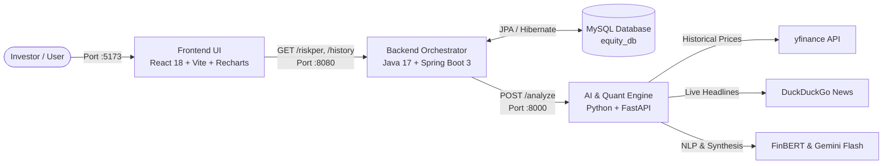

<div align="center">

# 📈 EquitySense

### AI-Powered Equity Research Tool using Predictive Analytics & Dynamic Market Sentiment Analysis

[](https://github.com/nilayg26/equity-sense)
[](https://react.dev/)
[](https://spring.io/projects/spring-boot)
[](https://fastapi.tiangolo.com/)
[](https://www.mysql.com/)
[](https://huggingface.co/ProsusAI/finbert)
[](https://ai.google.dev/)

**EquitySense** is a full-stack, multi-tier equity research platform that bridges quantitative price volatility with domain-specific financial Natural Language Processing (NLP) and Generative AI synthesis—delivering real-time composite risk scoring and cross-asset visual comparisons on a clean, Groww-inspired interface.

[Features](#-key-features) • [Architecture](#-system-architecture) • [Risk Methodology](#-hybrid-risk-methodology) • [Installation](#-installation--setup) • [Usage](#-usage-guide) • [Project Structure](#-project-structure)

</div>

---

## 📖 Project Overview

Retail investors often face fragmented workflows—forced to reconcile backward-looking price charts with fast-moving, unstructured financial news manually. Generic sentiment models frequently misinterpret financial terminology, while institutional terminals remain cost-prohibitive.

**EquitySense** solves this by uniting three analytical pillars inside an open-source, zero-infrastructure-cost architecture:
1. **Quantitative Volatility Modeling:** Computes annualized historical volatility from live market data (`yfinance`).
2. **Domain-Tuned Financial NLP:** Classifies live market news headlines using **ProsusAI/FinBERT** to quantify market sentiment polarity.
3. **Generative Executive Synthesis:** Uses **Google Gemini Flash** (with automatic model fallback cascading) to distill aggregated news into concise, investor-ready fundamental summaries.

---

## ✨ Key Features

- **⚖️ Hybrid 60/40 Risk Engine:** Combines historical price standard deviation ($60\%$ weight) with FinBERT news sentiment ($40\%$ weight) into a standardized $0\text{–}100\%$ risk score.
- **🧠 Domain-Specific Sentiment Analysis:** Processes live financial news via `ProsusAI/finbert` using a damped risk-mapping scale (`positive: 20.0`, `neutral: 50.0`, `negative: 80.0`) to prevent extreme single-headline distortion.
- **🤖 Automated Fundamental Digest:** Generates qualitative context explaining recent price drivers and catalysts via Google Gemini Flash.
- **📊 Cross-Asset Comparative Matrix & Charts:** Interactive **Recharts** grouped bar visualizations and comparative metric tables for evaluating multiple equities side-by-side.
- **⚡ Low-Latency MySQL Persistence:** Caches historical evaluations in `equity_db`, reducing repeat query latency from **~3 seconds** (live inference) to **<50 ms**.
- **🎨 Clean Financial Dashboard:** Responsive, Groww-inspired UI built with React 18, Vite, and Tailwind CSS featuring color-coded risk classification badges.

---

## 🏗️ System Architecture

EquitySense is engineered as a decoupled **3-Tier Microservice Architecture** separating presentation, enterprise orchestration, AI inference, and relational persistence:



| Tier | Component | Port | Responsibility |
| :--- | :--- | :---: | :--- |
| **Presentation** | React + Vite + Tailwind CSS | `:5173` | Ticker search, risk gauges, Recharts comparative matrix, and session history |
| **Orchestration** | Java 17 + Spring Boot 3.3.0 | `:8080` | REST gateway, inter-service routing (`RestTemplate`), CORS, and JPA persistence |
| **AI & Quant Engine** | Python + FastAPI + Uvicorn | `:8000` | Volatility math, DuckDuckGo scraping, FinBERT inference, and Gemini summaries |
| **Data Store** | MySQL Community Server | `:3306` | Relational persistence of `stock_analysis` entities in `equity_db` |

---

## 🧮 Hybrid Risk Methodology

### 1. Composite Risk Equation
EquitySense evaluates overall asset risk ($R$) as a weighted linear combination of normalized historical volatility ($V$) and news sentiment risk ($S$):

$$R = (0.60 \times V) + (0.40 \times S)$$

### 2. Component Formulations
* **Volatility Score ($V \in [0, 100]$):** Derived from the annualized standard deviation of daily logarithmic returns over a configurable 30-day lookback window ($\approx 21$ trading days) fetched via `yfinance`, scaled onto a $0\text{–}100$ index.
* **Sentiment Score ($S \in [20, 80]$):** Each retrieved headline is classified by `ProsusAI/finbert` into `positive` ($20.0$), `neutral` ($50.0$), or `negative` ($80.0$), and averaged across all $N$ headlines:

$$S = \frac{1}{N} \sum_{i=1}^{N} \rho(\ell_i) = 50 + 30 \cdot \left(\frac{N_{\text{neg}} - N_{\text{pos}}}{N}\right)$$

### 3. Risk Classification Tiers

| Risk Score ($R$) | Classification Tier | Dashboard Indicator | Interpretation |
| :---: | :--- | :---: | :--- |
| **$0\% \text{ – } 35\%$** | **Low Risk** | 🟢 Green | Stable price action supported by neutral-to-bullish market sentiment |
| **$36\% \text{ – } 60\%$** | **Moderate Risk** | 🟡 Amber | Balanced volatility and mixed news flow; standard market exposure |
| **$61\% \text{ – } 100\%$** | **High / Speculative Risk** | 🔴 Red | Elevated price swings and/or predominantly bearish news catalysts |

---

## 🛠️ Tech Stack

| Layer | Technologies |
| :--- | :--- |
| **Frontend** |     |
| **Backend** |    |
| **AI / Data Science** |     |
| **APIs & Database** |    |

---

## 🚀 Installation & Setup

### Prerequisites
Ensure the following are installed on your local machine:
- **Node.js** (v18+) & **npm**
- **Java Development Kit (JDK)** 17+ & **Maven**
- **Python** 3.10+ & **pip**
- **MySQL Server** (running locally on port `3306`)

### 1. Clone the Repository
```bash
git clone https://github.com/nilayg26/equity-sense.git
cd equity-sense
```

### 2. Database Setup (MySQL)
Log into your MySQL instance and create the target database (Hibernate automatically generates the `stock_analysis` table on startup):
```sql
CREATE DATABASE equity_db;
```

### 3. Start the Python AI Microservice (`:8000`)
```bash
cd ai_service
python -m venv venv

# Activate virtual environment
# On Windows:
venv\Scripts\activate
# On macOS/Linux:
source venv/bin/activate

pip install -r requirements.txt
```
Create a `.env` file inside `ai_service/` with your Gemini API key (see [Configuration](#-configuration)), then launch the FastAPI server:
```bash
uvicorn main:app --reload --port 8000
```
> *Note: On first startup, Hugging Face will download `ProsusAI/finbert` (~440 MB) and cache it locally.*

### 4. Start the Spring Boot Backend (`:8080`)
Open a new terminal window:
```bash
cd backend
mvn clean install
mvn spring-boot:run
```

### 5. Start the React Frontend (`:5173`)
Open a third terminal window:
```bash
cd frontend
npm install
npm run dev
```
Navigate to **`http://localhost:5173`** in your browser to access the EquitySense dashboard.

---

## ⚙️ Configuration

<details>
<summary><b>1. AI Service Environment Variables (<code>ai_service/.env</code>)</b></summary>

```env
GEMINI_API_KEY=your_google_gemini_api_key_here
```
</details>

<details>
<summary><b>2. Spring Boot Database Properties (<code>backend/src/main/resources/application.properties</code>)</b></summary>

```properties
server.port=8080

spring.datasource.url=jdbc:mysql://localhost:3306/equity_db?createDatabaseIfNotExist=true&useSSL=false&allowPublicKeyRetrieval=true
spring.datasource.username=root
spring.datasource.password=your_mysql_password

spring.jpa.hibernate.ddl-auto=update
spring.jpa.show-sql=true
```
</details>

---

## 💻 Usage Guide

### Web Dashboard Workflow
1. **Analyze a Stock:** Enter a valid market ticker symbol (e.g., `JPM`, `NVDA`, `AAPL`, `TSLA`) in the search bar and click **Analyze**.
2. **Inspect Risk Breakdown:** View the composite **Risk Percentage**, **Volatility Score**, **FinBERT Sentiment Score**, and **Gemini Fundamental Summary**.
3. **Compare Equities:** Analyze multiple tickers to populate the **Comparative Matrix** and **Recharts Bar Visualization** for side-by-side variance inspection.
4. **Review History:** Reloading the application automatically hydrates previous queries from MySQL via the `/history` endpoint.

### REST API Reference

| Method | Service | Endpoint | Description |
| :--- | :--- | :--- | :--- |
| `GET` | Spring Boot | `/riskper?ticker={SYMBOL}` | Orchestrates full AI analysis, persists to MySQL, and returns risk JSON |
| `GET` | Spring Boot | `/history` | Retrieves all previously analyzed equities stored in `equity_db` |
| `POST` | FastAPI | `/analyze` | Computes volatility, FinBERT sentiment, and Gemini summary for a ticker |

**Example Request:**
```bash
curl "http://localhost:8080/riskper?ticker=JPM"
```

---

## 📂 Project Structure

```text
equity-sense/
├── frontend/                          # React 18 + Vite + Tailwind CSS Client
│   ├── src/
│   │   ├── components/                # UI Gauges, Comparison Matrix & Recharts Views
│   │   ├── App.jsx                    # Main Dashboard & State Management
│   │   └── main.jsx                   # Application Entry Point
│   ├── package.json
│   └── vite.config.js
│
├── backend/                           # Java 17 + Spring Boot 3 Orchestrator
│   ├── src/main/java/.../
│   │   ├── controller/
│   │   │   └── StockController.java   # REST Endpoints (/riskper, /history)
│   │   ├── service/
│   │   │   └── StockService.java      # RestTemplate AI Gateway & Business Logic
│   │   ├── repository/
│   │   │   └── StockAnalysisRepository.java # Spring Data JPA Interface
│   │   └── model/
│   │       └── StockAnalysis.java     # JPA Entity Mapping (stock_analysis table)
│   ├── src/main/resources/
│   │   └── application.properties     # MySQL & Server Configuration
│   └── pom.xml
│
├── ai_service/                        # Python + FastAPI Quantitative & NLP Engine
│   ├── services/
│   │   ├── nlp_sentiment.py           # ProsusAI/FinBERT Pipeline & 20/50/80 Scoring
│   │   ├── volatility.py              # yfinance Log-Return Annualized Volatility
│   │   └── llm_summary.py             # Google Gemini Flash Synthesis & Fallback
│   ├── main.py                        # FastAPI App & /analyze Route
│   └── requirements.txt               # Python Dependencies
│
└── README.md
```

---

## 🖼️ Screenshots & Demo


| Main Research Dashboard | 
| :---: | 
| 

---

## 🔮 Future Scope

- **Probability-Weighted Sentiment:** Upgrade from discrete `argmax` label mapping (`20 / 50 / 80`) to expected-value probability weighting ($p_{\text{neg}} \times 80 + p_{\text{neu}} \times 50 + p_{\text{pos}} \times 20$) for smoother score transitions.
- **Fundamental SEC Filing Ingestion:** Parse quarterly $10\text{-Q}$ and annual $10\text{-K}$ filings (P/E ratio, Debt-to-Equity, Free Cash Flow) into the composite risk model.
- **Real-Time WebSocket Streaming:** Replace REST polling with bidirectional WebSockets for live tick-by-tick risk updates during market hours.


## 👥 Authors & Acknowledgements

Developed as part of **BCSE497J** at the **School of Computer Science and Engineering (SCOPE), VIT** under the supervision of **Prof. Sharmila C.**
- **Nilay Gupta** (`23BCE0978`)
- **Anisha Saha** (`23BCE0977`)
- **Khushi Tyagi** (`23BCT0090`)

### Acknowledgements
- [ProsusAI/FinBERT](https://huggingface.co/ProsusAI/finbert) by Dogu Araci for domain-tuned financial sentiment classification.
- [Google Gemini API](https://ai.google.dev/) for generative market news summarization.
- [yfinance](https://github.com/ranaroussi/yfinance) for open-source historical market data retrieval.
